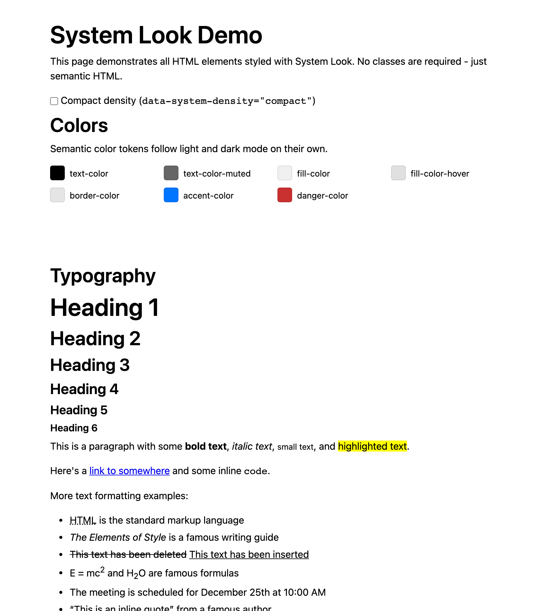

# System Look

A lightweight CSS library that provides beautiful defaults for native HTML elements without requiring any classes. Just include the CSS file and your semantic HTML will look great out of the box.



[View the live demo](https://rafalenden.github.io/system-look/demo/)

## Installation

### npm

```bash
npm install system-look
```

With a bundler (Vite, webpack, Parcel, esbuild…), import it once from your entry file:

```js
import 'system-look';
```

or from your own stylesheet:

```css
@import 'system-look';
```

Without a bundler, link the file directly:

```html
<link rel="stylesheet" href="node_modules/system-look/system.css">
```

### CDN

```html
<link rel="stylesheet" href="https://unpkg.com/system-look/system.css">
```

Pin a version (`system-look@1/system.css`) in production so a new release can't change your page.

### Download

Download `system.css` and include it in your project:

```html
<link rel="stylesheet" href="path/to/system.css">
```

## Usage

Just write semantic HTML and it will be styled automatically:

```html
<!DOCTYPE html>
<html>
<head>
    <link rel="stylesheet" href="system.css">
</head>
<body>
<h1>My Website</h1>
<p>This paragraph will be automatically styled.</p>

<form>
    <label for="email">Email:</label>
    <input type="email" id="email" placeholder="Enter your email">

    <label for="message">Message:</label>
    <textarea id="message" placeholder="Your message"></textarea>

    <button type="submit">Send</button>
</form>

<table>
    <thead>
    <tr>
        <th>Name</th>
        <th>Age</th>
    </tr>
    </thead>
    <tbody>
    <tr>
        <td>John</td>
        <td>25</td>
    </tr>
    </tbody>
</table>
</body>
</html>
```

## Dark Mode

System Look automatically adapts to your system's dark/light mode preference using `prefers-color-scheme`. No configuration needed!

## Customization

Everything is driven by custom properties declared on `:root`. Override the ones you need after loading the stylesheet:

```css
:root {
  --system-font-size-base: 0.875rem;
  --system-spacing-md: 0.75rem;
  --system-control-height: 1.75rem;
}
```

| Property | Default | Used for |
| --- | --- | --- |
| `--system-ui` | `system-ui`, then common platform fonts | Body font |
| `--system-ui-mono` | `'SF Mono'`, then common monospace fonts | `kbd`, `samp`, `var` |
| `--system-spacing-xs` … `--system-spacing-3xl` | `0.25rem` … `3rem` | Margins and padding |
| `--system-font-size-xs` … `--system-font-size-4xl` | `0.75rem` … `2.5rem` | Text and heading sizes |
| `--system-line-height` | `1.5` | Body line height |
| `--system-control-height` | `2.1875rem` | Minimum height of buttons, inputs, selects and textareas |
| `--system-label-font-weight` | `500` | Weight of `label` text; labels wrapping a checkbox or radio are always regular |

### Colors

Color tokens are built from the browser's system colors, so they switch with light and dark mode without a media query. Use them in your own rules to stay in step with the rest of the page:

| Property | Default | Used for |
| --- | --- | --- |
| `--system-text-color` | `CanvasText` | Body text |
| `--system-text-color-muted` | `CanvasText` at 60% opacity | `blockquote`, `caption`; secondary text in your own rules |
| `--system-background-color` | `transparent` | Page background |
| `--system-fill-color` | `CanvasText` at 6% opacity | `kbd` background; subtle surfaces |
| `--system-fill-color-hover` | `CanvasText` at 12% opacity | Not used by the library; hover state for your own controls |
| `--system-border-color` | `CanvasText` at 10% opacity | `kbd`, `hr` and `tfoot` borders |
| `--system-accent-color` | `AccentColor` where supported, otherwise a light/dark blue | Not used by the library; highlights in your own rules |
| `--system-danger-color` | `#c93030` light, `#ff6b6b` dark | Not used by the library; errors and destructive or active states |

```css
.mute-button:hover {
  background: var(--system-fill-color-hover);
}

.mute-button[aria-pressed='true'] {
  color: var(--system-danger-color);
}
```

When you override a color and want different light and dark values, use [`light-dark()`](https://developer.mozilla.org/docs/Web/CSS/color_value/light-dark):

```css
:root {
  --system-accent-color: light-dark(#1da0c3, #4cc3e0);
}
```

Checkboxes, radios, range inputs and progress bars keep the browser's own accent. To tint them with your color as well, set `accent-color`:

```css
:root {
  accent-color: var(--system-accent-color);
}
```

### Compact density

The default scale suits documents. For small interfaces such as browser extension popups, side panels and settings windows, opt in to the compact preset:

```html
<html data-system-density="compact">
```

It sets a 13px base font with headings from 13px to 18px, tighter spacing and line height, 28px controls and regular-weight labels. Individual tokens can still be overridden on top of it.

Sizes are in `rem`, so changing the root font size scales the whole stylesheet, with or without the preset:

```css
:root {
  font-size: 13px;
}
```

### Overriding rules

Rules only use element selectors (attribute and state checks are wrapped in `:where()`), so a single class in your own stylesheet always wins:

```css
.toolbar-button {
  min-height: 0;
  padding: 0;
}
```

If you would rather not think about source order at all, load the library into a [cascade layer](https://developer.mozilla.org/docs/Web/CSS/@layer); unlayered styles then take precedence over it:

```css
@import 'system-look' layer(system);
```

## Demo

The demo is a single static page with no dependencies. Open `demo/index.html` in a browser, or view it [online](https://rafalenden.github.io/system-look/demo/).

## License

[MIT](./LICENSE) - feel free to use in personal and commercial projects.
